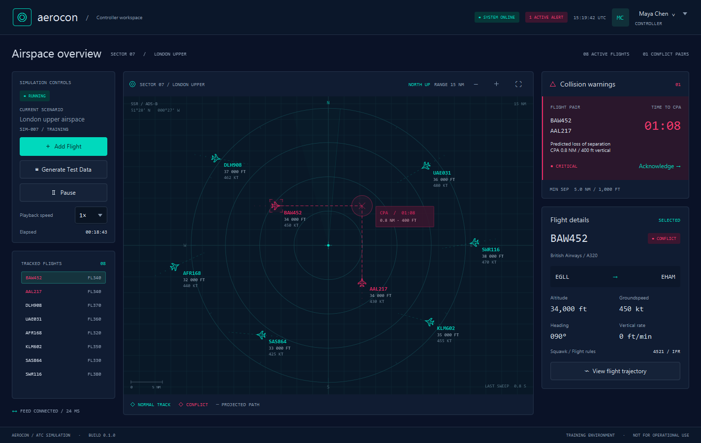

# Aerocon — JavaFX Prototype

A JavaFX air traffic monitoring interface prototype based on the supplied PDF mockups. It uses navy backgrounds, a cyan radar, red conflict warnings, and an English UI.



Other screens: [login](docs/screenshots/login.png), [administration](docs/screenshots/admin.png).

## Run on Windows

Double-click **run.cmd**, or run the following command from the project directory:

```powershell
.\run.cmd
```

The script uses a local JDK 21 and Maven from `.tools`. On the first run on another computer, it downloads these tools and verifies their checksums. An internet connection is required to download tools and dependencies; a system-wide Java installation is not required.

Demo credentials:

| Username | Password | Role |
| --- | --- | --- |
| `maya.chen` | `aerocon` | Controller |
| `sarah.patel` | `aerocon` | Admin |

Select the account's assigned role in the login form. Credentials, account status, and role are checked against the database.

If JDK 21+ and Maven are already installed, you can use `mvn javafx:run`. In IntelliJ IDEA, open `pom.xml` as a Maven project and select JDK 21.

## Database Setup (XAMPP / MariaDB)

The application uses a JDBC database for operator accounts and incident history. Start **MySQL** in the XAMPP Control Panel before launching Aerocon. XAMPP labels this service MySQL, but its server is MariaDB; the project uses [MariaDB Connector/J](https://mariadb.com/docs/connectors/mariadb-connector-j/about-mariadb-connector-j), which also supports MySQL servers.

For a new installation:

1. Start **MySQL** in XAMPP. Start **Apache** as well if you want to use phpMyAdmin.
2. Open phpMyAdmin using the **Admin** button next to MySQL. As a database administrator, run [database/create-database.sql](database/create-database.sql), replacing `CHANGE_ME` with your own database account password.
3. Copy [config/database.properties.example](config/database.properties.example) to `config/database.properties`. Set the same database account password:

   ```properties
   db.url=jdbc:mariadb://127.0.0.1:3306/aerocon
   db.user=aerocon
   db.password=YOUR_DATABASE_ACCOUNT_PASSWORD
   ```

4. Run `run.cmd`. The application creates `operators`, `incidents`, and `app_metadata` tables and inserts initial demo data once. Deleted users are not recreated on later launches.

The database password belongs to the database account, and is separate from passwords used to sign in to Aerocon. The local configuration file is excluded from Git. You can override its settings with `AEROCON_DB_URL`, `AEROCON_DB_USER`, and `AEROCON_DB_PASSWORD`, or select another file using the JVM property `-Daerocon.db.config=path/to/file.properties`.

The initial demo accounts above are stored with salted PBKDF2 password hashes. Their selected role must match the account role: `maya.chen` is a Controller and `sarah.patel` is an Admin. The administration panel can create accounts with their own usernames and passwords, update passwords, and enable or disable accounts. Newly created accounts can sign in immediately with their assigned role. At least one enabled administrator must remain.

## Features

- Database-backed login, password visibility toggle, assigned role validation, and logout through the user menu.
- Radar with eight initial flights, aircraft movement, selection on the radar or in the flight list, flight details, and trajectory display.
- Pause and resume, playback speeds from 1× to 8×, radar zoom, and full-screen mode.
- Flight creation with input validation and initial position selection on the radar.
- Generation of 1–50 aircraft at a time, with three presets, an optional conflict pair, randomized altitudes, commercial traffic, and an option to clear existing traffic.
- Independent warning acknowledgement for each conflict pair, saved to incident history with the operator username and UTC timestamp.
- Administration panel with persistent user accounts, operator search and role filtering, username/password management, deletion with confirmation, incident history filters, and CSV export of visible records.

Operator accounts and incident history persist in the database after the application closes. Flight tracks and simulation playback remain in memory and reset on restart. Aircraft movement and conflict scenarios are demonstrations; actual separation, CPA (closest point of approach), vertical motion, and time-to-CPA calculations are not implemented. Stored conflict details are explicitly marked as demo scenarios. Initial sample users and incidents are seeded once, and subsequent account changes and warning acknowledgements are saved to the database. Database operations run in background workers so the UI remains responsive.

## Project Structure

```text
project_po2/
├── pom.xml                              # Maven: Java/JavaFX versions, dependencies, build
├── run.cmd                              # double-click launcher for Windows
├── run.ps1                              # local tool downloads, build, and launch
├── verify.ps1                           # runs functional UI checks
├── README.md                            # overview, instructions, and this directory tree
├── .gitignore                           # excludes build output, caches, and IDE files
├── config/
│   └── database.properties.example      # database settings template; working credentials are ignored
├── database/
│   └── create-database.sql              # one-time database/account setup for a new computer
├── src/
│   ├── main/
│   │   ├── java/pl/aerocon/              # Java source code; pl.aerocon is the package name
│   │   │   ├── AeroconApplication.java   # entry point, login, controller view, navigation, timer
│   │   │   ├── data/                    # JDBC persistence, external configuration, password hashing
│   │   │   │   ├── AeroconRepository.java # storage contract used by the screens
│   │   │   │   ├── JdbcAeroconRepository.java # SQL queries, transactions, one-time demo data
│   │   │   │   ├── DatabaseConfig.java  # local properties and environment configuration
│   │   │   │   ├── PasswordHasher.java  # salted PBKDF2 password hashes
│   │   │   │   └── DataAccessException.java # storage errors suitable for the UI
│   │   │   ├── model/                   # domain data
│   │   │   │   ├── Flight.java          # aircraft parameters, coordinates, and initial demo flights
│   │   │   │   ├── Operator.java        # public account data without password hashes
│   │   │   │   └── Incident.java        # persisted incident details
│   │   │   └── ui/                      # UI components and dialogs
│   │   │       ├── RadarView.java       # Canvas: grid, rings, aircraft, paths, mouse selection
│   │   │       ├── SimulationDialogs.java # flight creation, traffic generator, input validation
│   │   │       ├── AdminView.java       # users, management dialogs, incident history, CSV export
│   │   │       └── Ui.java              # shared factories for buttons, labels, fields, and panels
│   │   └── resources/pl/aerocon/        # resources Maven includes in the application
│   │       ├── aerocon.css              # main JavaFX styles: palette, fonts, and UI controls
│   │       └── db/schema.sql            # application table definitions, applied at startup
│   └── test/java/pl/aerocon/
│       ├── PrototypeSmokeTest.java       # checks using actual UI controls
│       └── data/DatabaseIntegrationTest.java # real MariaDB persistence and authentication tests
├── docs/screenshots/                     # saved application previews
│   ├── login.png                        # login screen
│   ├── radar.png                        # controller screen
│   └── admin.png                        # administration screen
├── .tools/                              # local JDK and Maven downloaded by the launch script
├── target/                              # Maven build output: classes, JAR, reports
└── tmp/                                 # temporary PDF renders and verification screenshots
```

`.tools`, `target`, and `tmp` are excluded through `.gitignore`. Edit source files in `src`; files in `target` are regenerated during builds.

## Styling and Layout

- **Main theme — `src/main/resources/pl/aerocon/aerocon.css`.** `.root` defines the base colors and font, `.primary-button` styles the cyan buttons, `.panel` styles panels, `.warning-card` styles warnings, and `.table-view` styles tables. The stylesheet is loaded in `AeroconApplication.start()` and separately for dialogs.
- **Radar graphics — `src/main/java/pl/aerocon/ui/RadarView.java`.** The `BACKGROUND`, `GRID`, `RING`, `CYAN`, and `RED` colors, together with Canvas drawing commands, define the grid, rings, aircraft, and lines. Changing the CSS theme alone does not recolor the Canvas drawing.
- **Additional administration styles — `src/main/java/pl/aerocon/ui/AdminView.java`.** `setStyle()` calls define compact control sizes, status colors, and table row colors. They supplement and sometimes override the main CSS.
- **Layout — the Java classes for each screen.** `VBox`, `HBox`, `GridPane`, and `BorderPane` containers, dimensions, and spacing are configured in `AeroconApplication`, `AdminView`, and `SimulationDialogs`. `Ui.java` creates shared controls and assigns CSS classes.

The project has no FXML files: the interface is built programmatically with JavaFX.

## Build and Verify

Build without launching the application:

```powershell
.\run.cmd -BuildOnly
```

Run functional UI checks (opens a JavaFX test window):

```powershell
powershell -ExecutionPolicy Bypass -File .\verify.ps1
```

This uses the configured database, so use a separate database for automated verification. The repository integration tests are skipped unless an explicit test configuration is provided, and they only accept the local `aerocon_test` schema. The UI smoke test can use a separate configuration too:

```powershell
powershell -ExecutionPolicy Bypass -File .\verify.ps1 -DatabaseConfig .\tmp\database\smoke.properties -TestDatabaseConfig .\tmp\database\test.properties
```

These local test configuration files are not included in Git. Create dedicated `aerocon_smoke` and `aerocon_test` databases with the same setup procedure, and point each properties file to its respective database. Never point automated tests at an existing database containing important data.

The UI checks verify database readiness, rejected credentials and roles, login, pause and resume, forms, traffic generation, independent warning acknowledgement, and search in the administration panel. Repository tests verify persistence across connections, one-time seeding, CRUD, password hashing and changes, disabled accounts, role checks, duplicate account rejection, incident acknowledgement, and protection of the last enabled administrator.

The project uses Java 21, JavaFX 21, MariaDB Connector/J, and Maven. The main theme is defined in CSS; Canvas graphics and some additional styles are defined in Java code.
